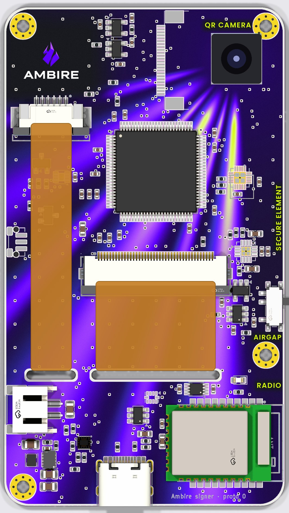

# Ambire hardware signer — proto 0

A Safe-owner signing device: STM32U585 + two secure elements from two vendors,
NXP SE050 and Infineon OPTIGA Trust M (an independent key generated inside each,
no seed phrase), BLE behind a hardware airgap switch, QR
camera, 2.4" capacitive touch display, clear case. Lives here temporarily, next
to the GridCore hardware it borrows from, until it moves to its own repo.

- [docs/research.md](docs/research.md) — threat landscape 2024–2026, how the
  incumbents are built, why this architecture
- [docs/design.md](docs/design.md) — the board, block by block, and the
  bring-up checks that need parts in hand
- [docs/ambire-signer.html](docs/ambire-signer.html) — the short concept page
  shared with the team (renders, clear-signing screens, stack, architecture);
  live copy: https://claude.ai/artifact/LLUtmWoVMm4PUxiSL7d5Ad



*The back face as the clear case shows it, with the UV-printed artwork (rebuilt from the current placement by `art/build_uv.py`). Display flex tails in orange; camera module drawn on.*

> **Routed with [humanizedKicadAutoRouter](https://github.com/Ivshti/humanizedKicadAutoRouter)**:
> a headless KiCad autorouter that routes the way a person does. It lays each
> functional block first, then power sized for its current, then the buses
> between blocks in planned corridors, and it counts a board as done only when
> KiCad's own DRC agrees. Here it pre-routes the wiring inside each block on
> top of the hand-routed copper (`scripts/partialRoute.py`) and serves as the
> gauge of how routable a placement is.

## Board flow

Same as the GridCore Nano: `index.circuit.tsx` and `src/blocks/` are the
**netlist** (no placement); `board/wallet.kicad_pcb` is the board, placed by
script once, routed by hand in KiCad.

```sh
cd hardware/ambire-wallet
npm install
KICAD_PY=/Applications/KiCad/KiCad.app/Contents/Frameworks/Python.framework/Versions/Current/bin/python3
npx tsci export index.circuit.tsx -f circuit-json -o board/netlist.circuit.json
python3 scripts/checkNets.py             # every named net reaches two pads
python3 scripts/checkMcuAf.py            # MCU signals vs ST's pin database
python3 scripts/jlcStock.py              # live JLC stock per part number
$KICAD_PY scripts/syncBoard.py           # dry run; --apply writes (close KiCad first)
$KICAD_PY scripts/checkPinNets.py        # IC pads vs datasheet pin tables, on the copper
$KICAD_PY scripts/checkFpc.py            # connector/lever/antenna orientation, tail lengths
scripts/trialRoute.sh                    # autoroute a copy with KiCadRoutingTools: failed nets / vias
$KICAD_PY scripts/refreshKeepouts.py        # redraw the keep-out rule areas after a connector moves
$KICAD_PY scripts/partialRoute.py --out /tmp/pr   # block wiring on a copy, hand copper kept
$KICAD_PY scripts/routeGauge.py --out /tmp/gauge  # how routable: full autoroute on a copy, metrics in gauge.json
$KICAD_PY scripts/checkParts.py board/wallet.kicad_pcb   # lands vs JLC's land per part
../../.venv-enclosure/bin/python enclosure/generate.py   # case from the board: enclosure/out/ (STEP, STL) + docs/enclosure/ (page preview)
```

- `board/footprints.json` picks each part's footprint, with pad maps where the
  netlist and the land disagree (USB-C, switches, FPC tabs).
- `board/wallet.pretty/` holds the lands KiCad does not ship: the SE050's NXP
  SOT1969-1 land, the E73 module, the hole-clear ALPS SKRT button, and the
  Nano's BQ25185 / TPS63802 / Molex 54132 / touch-FPC lands.
- `src/parts/stm32u585Pins.ts` is **generated** from ST's pin database by
  `scripts/genStm32Pins.py`; the MCU's signal pins are assigned in
  `src/parts/mcuAssign.json`.
- `scripts/newBoard.py --force` regenerates the board from scratch (outline,
  slots, stack-up, pours, keep-outs, placement, then the ratsnest pass of
  `scripts/optimizePlacement.py`) and **destroys hand work**.
- A part is assembled by JLC exactly when it carries a JLC part number. The
  display panel, camera module and cell are fitted by hand.
