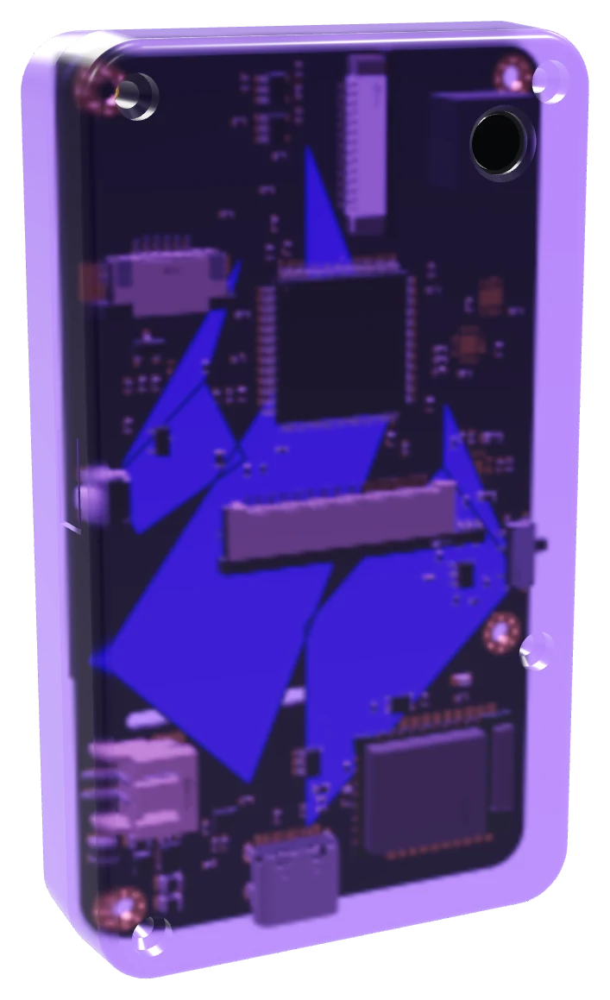

# Ambire hardware signer

A Safe-owner signing device: STM32U585 + two secure elements from two vendors,
NXP SE050 and Infineon OPTIGA Trust M, BLE behind a hardware airgap switch, QR
camera, 2.4" capacitive touch display, see-through case. Open hardware; the
firmware starts from a fork of Trezor's.

**Status (2026-10-22):** proto 0, the first three boards, is ordered from JLCPCB
(plain purple, the old wordmark on the back, a LiPo pouch, the OPTIGA not
fitted). The board file is now **proto 1**: one AAA cell of any chemistry in
clips on the front instead of the pouch (NiMH charged over USB only once
identified as NiMH), a case 6.5 mm thinner with the cell and the camera standing
out of it, a joystick below the cell, a buzzer, and the flame on the back. Why and
how: [docs/power-aaa.md](docs/power-aaa.md). The firmware port has started on the
fork (below), for proto 0.

*Render of the 3D model: the board's back face through the case, with the flame
in silkscreen. The front (screen side) carries no brand at all.*

Hand-routed by [@Ivshti](https://github.com/Ivshti), but component placement is
verified and optimized with
[humanizedKicadAutoRouter](https://github.com/Ivshti/humanizedKicadAutoRouter)
and [KiCadRoutingTools](https://github.com/drandyhaas/KiCadRoutingTools).

## Docs

- [docs/research.md](docs/research.md) — threat landscape 2024–2026, how the
  incumbents are built, why this architecture
- [docs/power-aaa.md](docs/power-aaa.md) — one AAA cell: which cells, how long
  they last, charging only NiMH, the power parts
- [docs/design.md](docs/design.md) — the board, block by block, the case, and
  the bring-up checks that need parts in hand
- [docs/direction.md](docs/direction.md) — open hardware, starting from Trezor's
  firmware (what stands in the way), the configurator and the board print schemes
- [firmware/README.md](firmware/README.md) — the Trezor firmware port: build,
  flash, what changed, bring-up checks
- [docs/board-flow.md](docs/board-flow.md) — netlist → board → checks → order
  set: the commands and the order-time steps
- [art/README.md](art/README.md) — the back print: the flame silkscreen and the
  full-colour print for PCBWay
- [board/experiments/README.md](board/experiments/README.md) — placement
  candidates and how they were judged
- [docs/ambire-signer.html](docs/ambire-signer.html) — the concept page shared
  with the team (3D model, configurator with DIY downloads, clear signing,
  architecture, status); public copy: https://ambiretech.github.io/secure-signer/
  (deployed by `.github/workflows/concept-page.yml`); the old Claude artifact
  link (https://claude.ai/artifact/LLUtmWoVMm4PUxiSL7d5Ad) now points there.
  That page shows proto 0 and stays as it is.
- [docs/v2/index.html](docs/v2/index.html) — the same page for proto 1 (the AAA
  cell, the joystick, the thinner case), with its own model and downloads:
  https://ambiretech.github.io/secure-signer/v2/ (the proto 0 page does not link it)

## Firmware

Trezor's firmware, ported to this board: `firmware/trezor-firmware/` is
[trezor-firmware](https://github.com/trezor/trezor-firmware) with our changes on
top, started from `5fdc180` (2026-10-16). Every Monday a workflow pulls Trezor's
new commits from their `main` into this repo (Trezor → us; nothing goes back to
Trezor), keeps our changes on top, builds, and opens a PR here; the current base
is the first line of `firmware/vendor-pins.txt`. It builds as Trezor's T3T2
model with our own board, `ambire_p0`: our pin map, the display over SPI
(Trezor's is parallel), the FT5426 touch, and a power latch in the boardloader.
Development keys only, for the bench. The secure elements, radio, camera,
charger and battery gauge are not driven yet.

`firmware/docker-build.sh` builds it in Docker with Trezor's own toolchain.
Build, flashing, syncing with Trezor, the full list of changes and the bring-up
checks: [firmware/README.md](firmware/README.md). What is left and why:
[docs/direction.md](docs/direction.md#2-trezor-compatible-start-from-trezors-firmware).

## Board

The board is KiCad (`board/wallet.kicad_pcb`), with the netlist in tscircuit
(`index.circuit.tsx`, `src/blocks/`). How it is checked and turned into an
order: [docs/board-flow.md](docs/board-flow.md). The order set is in
`production/order/` (JLCPCB, and PCBWay for the full-colour back print).

## Similar projects

- [wedgie.dev](https://wedgie.dev)
- [Keycard Shell](https://keycard.tech/products/keycard-shell): an open-source,
  air-gapped signer around a Keycard smart card, with a camera for animated QR
  and no radio
- picowallet (Austin Griffith, 2026-09): the same key model, a P-256 key
  generated in an ATECC608 behind a vault contract, on an RP2350
  (see [docs/research.md](docs/research.md#competitive-notes))
