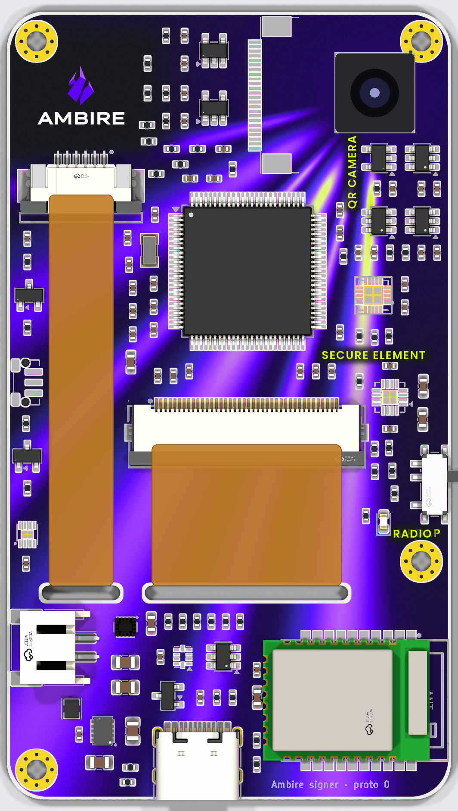

# Back-face UV artwork: Ambire signer



## Concept

**"The only way in is light."** The signer is air-gapped, so a transaction can only reach it as a QR code read through the camera window. The artwork makes that literal. The back is printed in Ambire Black, and beams of Ambire Volt, Violet and Purple, with a Signal Blue fringe, fan out of the camera window across the board in the style of the brand's "Flare" backgrounds. The beams are aimed at the parts of the board that stay visible between components. The official vertical Ambire logo (colour symbol, white wordmark, the brand's "over black" colourway) sits alone in the quiet top-left corner, with its full clear space. The functional labels (AIRGAP, RADIO, SECURE ELEMENT, QR CAMERA) are set in Poppins SemiBold in Volt, on a darkened patch so a beam never washes them out.

## Directions considered

See `directions.png`:

- **A · Flare** (chosen). A dark base makes the parts look precise and expensive. Colour shows up only where light "travels", so the busy areas stay calm. The concept is tied to what the product actually does. On a white-mask board, dark ink also hides solder flux stains and handling marks best.
- **B · Liquid.** This is the brand's signature texture, but between dense parts it reads as noise. Its bright areas also compete with the parts and with the logo.
- **C · Facets** (Modern Bold). Clean, but a flat purple-to-blue gradient reads as "coloured solder mask". It does not say anything about the product.

## Brand sources

Everything comes from github.com/AmbireTech/ambire-brand, commit `5939a5bf` (2026-06-01).

- **Logo:** `Logos/Ambire/SVG/Ambire-ver-on-dark.svg`, copied unmodified into `brand/`. Directions B and C use `logo-ver-simplified-white.svg`.
- **Colours:** *Ambire Brand Basics.pdf* v2.0, pages 49 and 51:
  - Purple `#6000FF`
  - Black `#181A1F`
  - White `#DCE2F2`
  - Violet `#AF50FF`
  - Volt `#D7FF00`
  - Signal Blue `#3871FF`
  - Heat `#FE4648` (not used)
- **Font:** Poppins, the brand's main typeface (page 43). The file `brand/Poppins-SemiBold.ttf` is from Google Fonts and licensed under the OFL (`brand/Poppins-OFL.txt`).
- **Rules followed** (pages 37–41): the logo keeps its clear space, it is not stretched, recoloured or given effects, it is not repeated as a pattern, and it sits on high contrast.

## JLCPCB process (researched 2026-10-14)

JLC calls this service "EasyEDA multi-color silkscreen". Sources:

- [H] https://jlcpcb.com/help/article/how-to-design-multi-color-silkscreen-using-easyeda
- [E] https://prodocs.easyeda.com/en/pcb/other-draw-colorful-silkscreen/
- [G] https://prodocs.easyeda.com/en/pcb/export-pcb-fabrication-file-gerber/
- [N] https://jlcpcb.com/news/multi-color-silkscreen-pcb
- [R] https://jlcpcb.com/resources/multicolor-silkscreen-pcb
- [C] https://jlcpcb.com/capabilities/pcb-capabilities

| Item | What we found |
|---|---|
| Toolchain | **EasyEDA Pro only** [H]. It exports extra files (`.FCTS` / `.FCBS` / `.FCBO`) alongside the Gerbers [G]. There is no official KiCad route. |
| Image input | PNG or SVG, placed on the board with "place original image" [H, E]. Older JLC pages say JPG/PNG. |
| Resolution | 6-colour UV printer, up to **1200 DPI** [E, N]. That is why we deliver 1200 DPI. JLC does not state a required input DPI. |
| Colour profile | Not stated. We deliver sRGB. |
| Solder mask | **White only** [H, E]. A "board colour" base, white by default and set per side, is printed first, then the image [E]. |
| Sides / stackup | Top and/or bottom; 2 or 4 layers; 0.4–2.0 mm thick; FR4; **ENIG only** [H, E]. |
| Min. features | Colour text 0.8 mm [R]. The general legend rules are 0.15 mm lines, 1.0 mm text, 0.15 mm from pads [C]. Our labels use 0.85 mm caps. |
| Normal silkscreen | Printed by the same colour process, in a per-part or default colour [E]. A separate white pass is not mentioned. |
| Clearances | No colour-specific rule was published. We keep 0.10 mm of bare mask around every opening and hole, and 0.30 mm from the outline and slots. |
| Alignment | The image is placed on the board outline in EasyEDA, and JLC adds an outline-mark file [G]. If JLC's own Gerber edits move things by more than 2 mm, the colour print is dropped [H]. |
| Assembly | The panel needs edge rails or the colour print is skipped. Boards under 70×70 mm get rails automatically [H]. |
| Cost / time | From $6.71, but [N] and [R] do not say whether that is per order or per board. Lead time is +1 day. ENIG is mandatory. |
| Bottom mirroring | **Not documented.** |

## Files

- `out/uv_back_seen_from_behind.png`: **the print file**. RGBA, 1200 DPI, 2268×3874 px = 48.00×82.00 mm. It shows the back as a person sees it. Transparent pixels mean no ink.
- `out/uv_back_kicad_front_view.png`: the same image mirrored, in KiCad's front-looking coordinates (the frame bottom-layer Gerbers use).
- `out/check_no_ink.png`: the art over white mask, with every pad, opening, drill and the camera window in red. Red must never touch colour; the build also checks this itself.
- `preview_back.png`: the art on a fresh 3D render of the back.
- `preview_back_assembled.png`: the same with the two display flex tails and the camera module drawn on.
- `directions.png`: the three concepts.

## Rebuild after placement changes

```
python3 -m venv .venv && .venv/bin/pip install pillow numpy
.venv/bin/python build_uv.py               # print files + previews (~30 s)
.venv/bin/python build_uv.py --directions  # also directions.png
```

The script needs `kicad-cli` (KiCad 10) and `rsvg-convert` on the PATH. It only reads `../board/wallet.kicad_pcb`. Each run re-derives the following from the board:

- **Outline and slots:** from Edge.Cuts.
- **No-ink areas:** the B.Mask openings and every PTH/NPTH drill and slot (via kicad-cli), plus the CAMERA window.
- **Logo, camera and flex-tail zones:** from the labelled Dwgs.User rectangles `UV ARTWORK`, `CAMERA`, `TFT TAIL` and `TOUCH TAIL`. Move a rectangle and the art follows.
- **Label positions:** from the board-level B.SilkS texts. Each label is moved to the nearest spot clear of courtyards, no-ink areas and the flex tails. If there is no room, it falls back to 0.80 mm caps, then to vertical text. The script prints every move. A label that cannot fit is left out with a warning.

Options: `--direction`, `--dpi`, `--pad-margin`, `--edge-margin`.

## Open questions

1. **How to order from KiCad.**
   - Option (a): import the KiCad project into EasyEDA Pro, place `uv_back_seen_from_behind.png` on the bottom colour-silkscreen layer, and export from there.
   - Option (b): one KiCad forum report (forum.kicad.info/t/57032) says JLC support accepted Gerbers plus an e-mailed image. That is hearsay, so ask JLC first.
2. **Bottom-side orientation in EasyEDA.** It is not documented whether EasyEDA mirrors a bottom image itself. Use whichever of the two PNGs makes the text read correctly in EasyEDA's 3D **bottom** view, and check the AIRGAP/RADIO positions against the switch.
3. **The white mask shows through on purpose** as a 0.10 mm ring around each pad and a 0.30 mm rim at the edge. Ask JLC what clearance they apply themselves; if they pull the ink back too, `--pad-margin 0` may be correct.
4. **Remove the plain B.SilkS labels** `AMBIRE`, `QR CAMERA`, `SECURE ELEMENT`, `AIRGAP` and `RADIO`. Otherwise they print a second time over the art. The preview already leaves them out.
5. **Price is unconfirmed** (per order or per board), and the mandatory white mask + ENIG needs a check against the current fab spec.
6. The image is noisy by design (brand texture grain), which makes each PNG about 14 MB. Keep them out of git if that matters.
