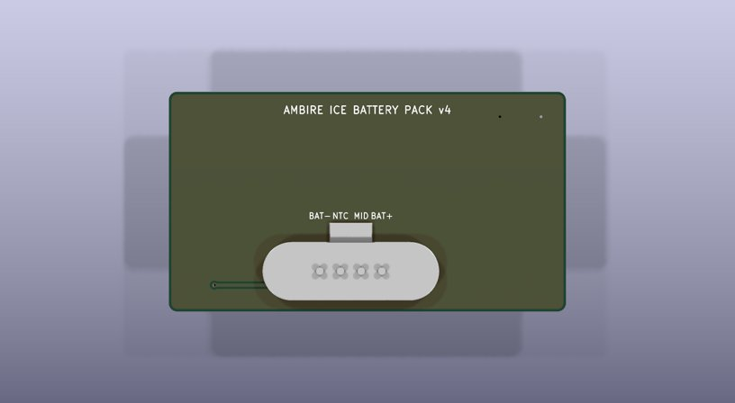
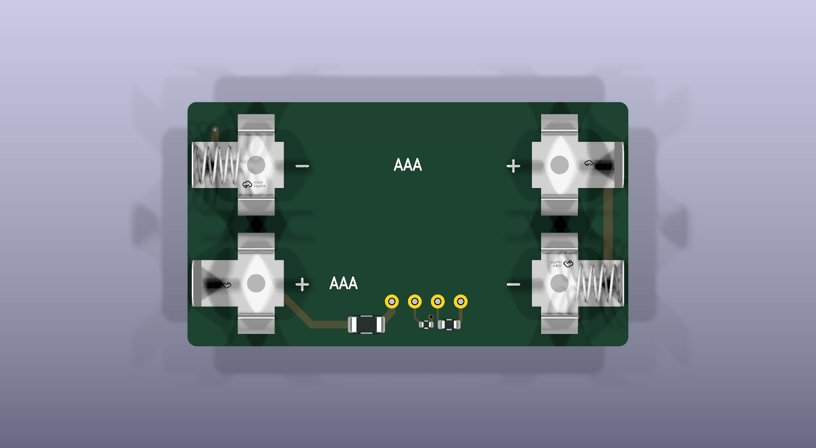

# The battery pack's board (v4)

Ambire Ice v4 runs from two AAA cells in a pack that snaps onto its back (why and how:
[../docs/pack.md](../docs/pack.md)). This is the pack's own board: the cells' clips on
one face, Xinyangze's 4-pin magnetic pogo male on the other, the face toward the device.
The male's magnets hold the pack on two steel spacers on the device board; its pins press
on four plain gold pads there.

48.0 × 26.4 mm, 2 layers, 0.8 mm thick, ENIG, routed.




*Rendered by KiCad: the outer face (toward the device), and the inner face seen from
behind, mirrored.*

## What is on it

| Part | Face | JLC / LCSC |
|---|---|---|
| Xinyangze YZP0048-20048-04025-03, 4-pin magnetic pogo male, through-hole (from the owner's own stock in the JLC parts library) | outer | C5126845 |
| MYOUNG MY-AAA-19-J, AAA clip (−, spring) ×2 | inner | C6937104 |
| MYOUNG MY-AAA-20-J, AAA clip (+) ×2 | inner | C6937107 |
| BHFUSE BSMD1206-075-30V, resettable fuse, 0.75 A hold | inner | C976305 |
| Murata NCP18XH103F03RB, 10 k thermistor (B 3380 K), 0603 | inner | C13564 |
| 1 k resistor, 0402 | inner | C11702 |

The two cells are in series: the south cell's plus goes through the fuse to the BAT+
pin; its minus meets the north cell's plus at the west clips (the mid-point, MID),
which reaches its pin through the 1 k resistor; the north cell's minus is BAT−. The
thermistor sits between the NTC pin and BAT−, for the charger's temperature input. A
coin across the pins never shorts a cell hard: plus to minus runs through the fuse, any
short to MID through the 1 k resistor.

The outer face carries only the male, the mid-point's run under its body and a BAT− pour.
The pin order lives in one place, `PIN_NETS` in `makePack.py`.

**Where the contacts go.** Over the device's pads and spacers, which lie east-west south of
the device's MCU (x 22.0, y 40.93 in device board coordinates): along the south cell, the
male's tab north, its four pins in a row under the cell's south flank, plus at the east
end. The clips hold only the cells' ends, so the joints are well clear of any of their
steel, and the cells lie side by side, 12.8 mm apart: 1.8 mm between neighbouring clips'
arms, twice the ~0.9 mm each arm swings out as a cell goes in (on the east side those arms
are the pack's minus and the south cell's plus, ahead of the fuse). `makePack.py` reads the
male's place and the clips' steel from the case (`enclosure.json`) and refuses a joint
within 0.3 mm of the steel.

**The small parts** sit in the strip south of the south cell's can, where nothing stands
over them, each straddling its pin's line: the thermistor between BAT− and NTC, the 1 k
resistor at MID, the fuse east of BAT+. The mid-point reaches the resistor from the
south-west clip on the outer face, under the male's body.

**The male's land** is ours, from Xinyangze's drawing (2022-03-24): four 0.80 mm holes at
2.50 mm, in 1.50 mm pads (the drawing recommends 2.20; smaller so the inner face clears the
AAA clips' steel). EasyEDA's land for C5126845 stacks a 2.2 mm SMD pad on a 0.85 mm
through-hole pad with a 0.05 mm ring, not used. Its 3D model (`3d/`, by `connModel.py`) is
drawn from the same drawing.

## Files

- `pack.kicad_pcb`, `pack.kicad_pro`: the board and its rules (Power class 0.8 mm for the
  cells, the fuse and the pins; 0.25 mm for the sense lines).
- `makePack.py`: builds the board from scratch from `docs/v4/enclosure/enclosure.json`
  (outline, cells, the male's place, the clips' steel) and its own constants (the parts, the copper). After a
  hand edit, edit the board instead.
- `../production/boardOrder.py`: writes `../production/pack-order/` (Gerbers and drill zip,
  JLC BOM and CPL, `stock.txt` with JLC's live stock).

```sh
KICAD_PY=/Applications/KiCad/KiCad.app/Contents/Frameworks/Python.framework/Versions/Current/bin/python3
$KICAD_PY pack/makePack.py                                  # the board (overwrites it)
kicad-cli pcb drc --severity-all pack/pack.kicad_pcb        # as saved, and again with --refill-zones
$KICAD_PY production/boardOrder.py pack/pack.kicad_pcb production/pack-order pack 200   # the order files
```

## Ordering at JLC

- **Assembly:** SMT on the inner face (the clips, the fuse, the thermistor and the
  resistor), and the male through-hole on the outer face, from the owner's own stock in the
  JLC parts library.
- **Stock:** `stock.txt` marks any part whose stock covers fewer than 200 packs as SHORT.
  On 2026-11-19 two do: the male (14 public at JLC: the owner's own stock is what is used)
  and the + clip MY-AAA-20-J (12 at JLC, 10 at LCSC: 6 packs), which needs a source
  before a run.
- **Rotations:** check every part in JLC's placement preview before paying. The clips
  carry the same rotation as the device board's (the south cell's exactly so, the
  north cell's turned 180°); check the male's tab points north. The CPL's rotations are KiCad's, not confirmed by JLC.
- The board is 0.8 mm thick and ENIG: pick both in the order form.

What the checks cover: DRC at every severity (none found, with and without a zone
refill), full connectivity, no stale copper. What they do not: the magnets' hold on the
device's steel spacers and the pins' contact on its pads, the clips holding cells on a 0.8 mm board, the fuse's heating at full
load, the fit in the tray. These files have not been ordered yet.
