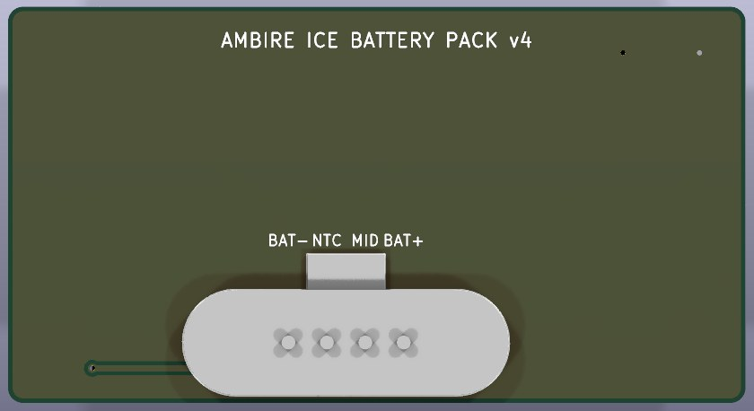
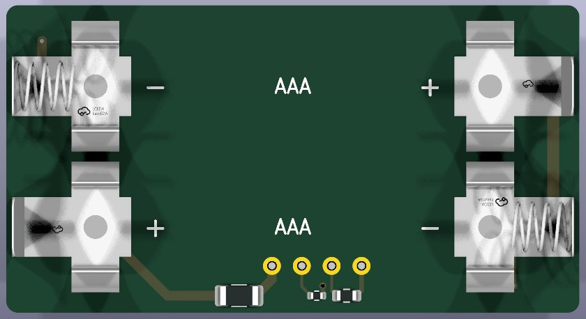

# The battery pack's board (v4)

Ambire Ice v4 runs from two AAA cells in a pack that snaps onto its back (why and how:
[../docs/pack.md](../docs/pack.md)). This is the pack's own board: the cells' clips on
one face, a magnetic pogo connector on the other, the face toward the device. The
connector's magnets, and the matching receptacle's on the device, hold the pack.

48.0 × 25.8 mm, 2 layers, 0.8 mm thick, ENIG, routed.




*Rendered by KiCad: the outer face (toward the device), and the inner face seen from
behind, mirrored.*

## What is on it

| Part | Face | JLC / LCSC |
|---|---|---|
| Xinyangze YZP0048-20048-04025-03, 4-pin magnetic pogo male, through-hole (1 A per pin) | outer | C5126845 |
| MYOUNG MY-AAA-19-J, AAA clip (−, spring) ×2 | inner | C6937104 |
| MYOUNG MY-AAA-20-J, AAA clip (+) ×2 | inner | C6937107 |
| BHFUSE BSMD1206-075-30V, resettable fuse, 0.75 A hold | inner | C976305 |
| Murata NCP18XH103F03RB, 10 k thermistor (B 3380 K), 0603 | inner | C13564 |
| 1 k resistor, 0402 | inner | C11702 |

The two cells are in series: the south cell's plus goes through the fuse to the BAT+
pin; its minus meets the north cell's plus at the west clips (the mid-point, MID),
which reaches its pin through the 1 k resistor; the north cell's minus is BAT−. The
thermistor sits between the NTC pin and BAT−, for the charger's temperature input. A
coin across the pins never shorts a cell hard: plus to minus runs through the fuse, any
short to MID through the 1 k resistor.

The outer face carries only the connector, the mid-point's run under its tab and a BAT−
pour. The pin order lives in one place, `PIN_NETS` in `makePack.py`.

**Where the connector goes.** Over the device's receptacle, which lies east-west south
of the device's MCU (x 22.0, y 42.28 in device board coordinates): along the south cell,
its tab north, its four pins in a row under the cell's south flank, plus at the east end.
The clips hold only the cells' ends, so the joints are 7 mm from any of their steel, and
the cells lie side by side, 11.8 mm apart with the clips' courtyards touching. The joints
are flat (see below) and sit 0.89 mm under the south cell's can. `makePack.py` reads the
connector's place and the clips' steel from the case (`enclosure.json`) and refuses a
joint within 0.3 mm of the steel.

**The small parts** sit in the strip south of the south cell's can, where nothing stands
over them, each straddling its pin's line: the thermistor between BAT− and NTC, the 1 k
resistor at MID, the fuse east of BAT+. The mid-point reaches the resistor from the
south-west clip on the outer face, under the connector's body.

**The connector's land** is ours, from Xinyangze's drawing (2022-03-24): four 0.80 mm
holes at 2.50 mm, in 1.50 mm pads where the maker draws 2.20 mm (they were sized to
clear the clips' feet when the pins stood between the cells; they stay small). EasyEDA's land for C5126845 stacks a 2.2 mm SMD pad on a 0.85 mm
through-hole pad with a 0.75 mm drill, a 0.05 mm ring: not used. Its tails are 0.70 mm
long and end inside the 0.8 mm board, so the joints on the inner face are flat. The 3D model (`3d/`, by `connModel.py`) is drawn from the same drawing.

## Files

- `pack.kicad_pcb`, `pack.kicad_pro`: the board and its rules (Power class 0.8 mm for the
  cells, the fuse and the pins; 0.25 mm for the sense lines).
- `makePack.py`: builds the board from scratch from `docs/v4/enclosure/enclosure.json`
  (outline, cells) and its own constants (the connector, the parts, the copper). After a
  hand edit, edit the board instead.
- `makeOrder.py`: writes `../production/pack-order/` (Gerbers and drill zip, JLC BOM and
  CPL, `stock.txt` with JLC's live stock).

```sh
KICAD_PY=/Applications/KiCad/KiCad.app/Contents/Frameworks/Python.framework/Versions/Current/bin/python3
$KICAD_PY pack/makePack.py                                  # the board (overwrites it)
kicad-cli pcb drc --severity-all pack/pack.kicad_pcb        # as saved, and again with --refill-zones
$KICAD_PY pack/makeOrder.py                                 # the order files
```

## Ordering at JLC

- **Assembly:** SMT on the inner face (the clips, the fuse, the thermistor, the resistor),
  and the connector is **through-hole** on the outer face. In the order form: PCBA on
  the **bottom** side for SMT, and tick **through-hole (THT) assembly** for J_PACK
  (JLC hand-solders it after reflow), or leave J_PACK out
  and solder it by hand: four joints on the inner face, done before the cells go in.
- **Stock:** the connector had 26 in JLC's own stock on 2026-10-28: enough for a few
  boards, not a run.
- **Rotations:** check every part in JLC's placement preview before paying. The clips
  carry the same rotation as the device board's (the south cell's exactly so, the
  north cell's turned 180°); the connector's tab points west, toward the middle of the
  board. The CPL's rotations are KiCad's, not confirmed by JLC.
- The board is 0.8 mm thick and ENIG: pick both in the order form.
- **Order samples of both halves first.** The device's receptacle (Xinyangze
  YZ103915020T-04025-02, C6276862) is from another family: its contacts are 2.54 mm
  apart against the male's 2.50 (the outer pins land 0.06 mm off centre), and its
  magnets are about 14.6 mm apart against the male's 15.41 mm. Whether they mate,
  attract and hold is for samples to show.

What the checks cover: DRC at every severity (none found, with and without a zone
refill), full connectivity, no stale copper. What they do not: the two connector
families mating, the clips holding cells on a 0.8 mm board, the fuse's heating at full
load, the fit in the tray. These files have not been ordered yet.
