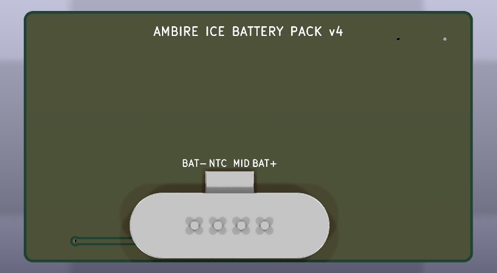
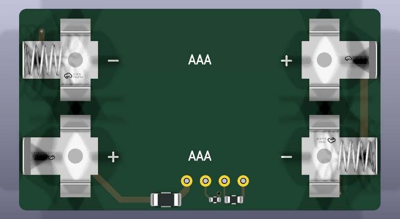

# The battery pack's board (v4)

Ambire Ice v4 runs from two AAA cells in a pack that snaps onto its back (why and how:
[../docs/pack.md](../docs/pack.md)). This is the pack's own board: the cells' clips on
one face, four spring pins and the seats of two magnets on the other, the face toward the
device. The magnets, in a printed frame, hold the pack on two steel spacers on the device
board; the pins press on four gold target discs there.

48.0 × 26.6 mm, 2 layers, 0.8 mm thick, ENIG, routed.




*Rendered by KiCad: the outer face (toward the device), and the inner face seen from
behind, mirrored.*

## What is on it

| Part | Face | JLC / LCSC |
|---|---|---|
| Xinyangze YZP0058-20048-02, spring pin, SMD with a peg (1 A) ×4 | outer | C5157341 |
| Radial Magnets 8063, NdFeB N40 magnet, 3.18 × 3.18 mm ×2 (glued into the frame, not assembled by JLC) | outer | DigiKey 469-8063-ND |
| MYOUNG MY-AAA-19-J, AAA clip (−, spring) ×2 | inner | C6937104 |
| MYOUNG MY-AAA-20-J, AAA clip (+) ×2 | inner | C6937107 |
| BHFUSE BSMD1206-075-30V, resettable fuse, 0.75 A hold | inner | C976305 |
| Murata NCP18XH103F03RB, 10 k thermistor (B 3380 K), 0603 | inner | C13564 |
| 1 k resistor, 0402 | inner | C11702 |

The two cells are in series: the south cell's plus goes through the fuse to the BAT+
pin; its minus meets the north cell's plus at the west clips (the mid-point, MID),
which reaches its pin through the 1 k resistor; the north cell's minus is BAT−. The
thermistor sits between the NTC pin and BAT−, for the charger's temperature input. A
coin across the pins never shorts a cell hard: plus to minus runs through the fuse, any
short to MID through the 1 k resistor.

The outer face carries only the pins, the frame's two peg holes, the mid-point's run under
the frame and a BAT− pour. The magnets stand on it over the device's steel, in the
frame's pockets. The pin order lives in one place, `PIN_NETS` in `makePack.py`.

**Where the contacts go.** Over the device's discs and spacers, which lie east-west south
of the device's MCU (x 22.0, y 42.28 in device board coordinates): along the south cell,
the frame's tab north, the four pins in a row under the cell's south flank, plus at the
east end. The clips hold only the cells' ends, so the holes are 5.6 mm from any of their steel, and
the cells lie side by side, 12.8 mm apart: 1.8 mm between neighbouring clips' arms, twice
the ~0.9 mm each arm swings out as a cell goes in (on the east side those arms are the
pack's minus and the south cell's plus, ahead of the fuse). `makePack.py` reads the
contacts' place, the magnets and the clips' steel from the case (`enclosure.json`) and
refuses a hole within 0.3 mm of the steel.

**The small parts** sit in the strip south of the south cell's can, where nothing stands
over them, each straddling its pin's line: the thermistor between BAT− and NTC, the 1 k
resistor at MID, the fuse east of BAT+. The mid-point reaches the resistor from the
south-west clip on the outer face, under the frame.

**The pins' land** is JLC's own (EasyEDA's for C5157341): four quadrant pads in a 2.0 mm
square round a plated hole for the pin's 0.40 mm peg. The hole is 0.50 mm here (EasyEDA
draws 0.40, no room for the peg), with a 1.30 mm ring that joins the quadrants in copper.
Plated, the hole carries each pin to the inner face, where its run starts. The frame's
footprint (`Pack_Frame`, written by `makePack.py`) is its two 1.1 mm peg holes, with the
outline and the magnets on F.Fab; it is out of the BOM and the CPL. The pin's 3D model
(`3d/`, by `connModel.py`) is drawn from Xinyangze's drawing (2015-05-14).

## Files

- `pack.kicad_pcb`, `pack.kicad_pro`: the board and its rules (Power class 0.8 mm for the
  cells, the fuse and the pins; 0.25 mm for the sense lines).
- `makePack.py`: builds the board from scratch from `docs/v4/enclosure/enclosure.json`
  (outline, cells, contacts, magnets, frame) and its own constants (the parts, the copper). After a
  hand edit, edit the board instead.
- `../production/boardOrder.py`: writes `../production/pack-order/` (Gerbers and drill zip,
  JLC BOM and CPL, `stock.txt` with JLC's live stock).

```sh
KICAD_PY=/Applications/KiCad/KiCad.app/Contents/Frameworks/Python.framework/Versions/Current/bin/python3
$KICAD_PY pack/makePack.py                                  # the board (overwrites it)
kicad-cli pcb drc --severity-all pack/pack.kicad_pcb        # as saved, and again with --refill-zones
$KICAD_PY production/boardOrder.py pack/pack.kicad_pcb production/pack-order pack 200   # the order files
```

## Ordering at JLC

- **Assembly:** SMT on **both** faces: the pins on the outer face (top), the clips, the
  fuse, the thermistor and the resistor on the inner face (bottom).
- **Stock:** the pins have 1,216 at JLC (2026-11-01): 304 packs. `stock.txt` marks any
  part whose stock covers fewer than 200 packs as SHORT. The magnets come from DigiKey.
- **Rotations:** check every part in JLC's placement preview before paying. The clips
  carry the same rotation as the device board's (the south cell's exactly so, the
  north cell's turned 180°); the pins are round, so their rotation does not matter. The CPL's rotations are KiCad's, not confirmed by JLC.
- The board is 0.8 mm thick and ENIG: pick both in the order form.

What the checks cover: DRC at every severity (none found, with and without a zone
refill), full connectivity, no stale copper. What they do not: the magnets' hold on the
device's steel spacers and the pins' contact on its discs, the glue, the clips holding cells on a 0.8 mm board, the fuse's heating at full
load, the fit in the tray. These files have not been ordered yet.
